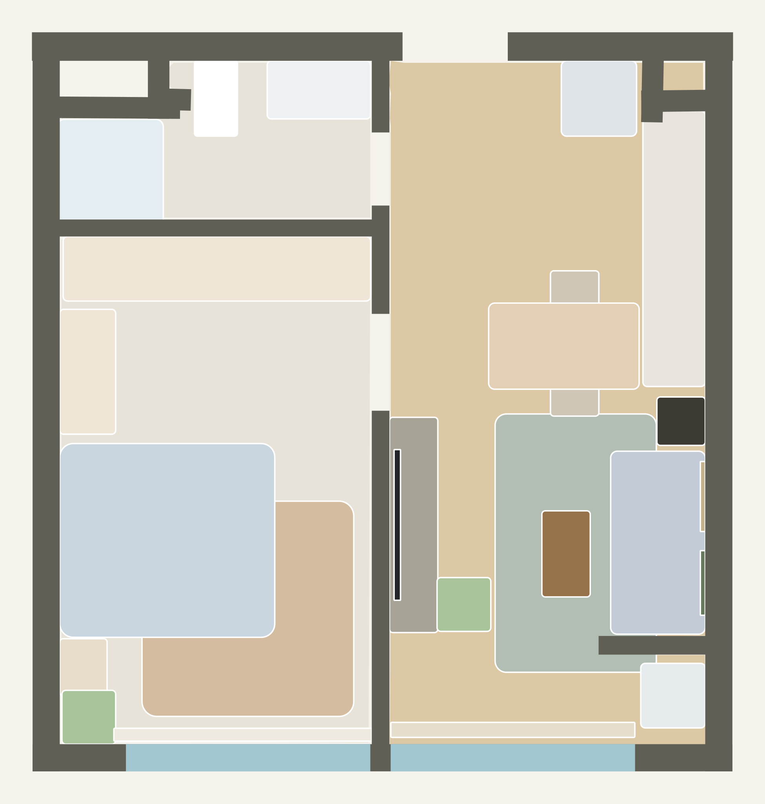
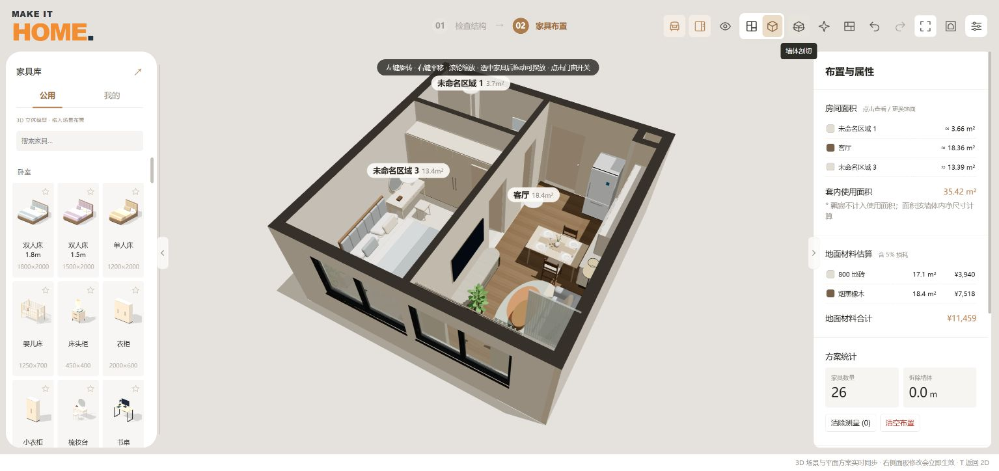

# Make It Home

把一张户型图，变成可以亲手布置的家。

Make It Home 是一个在本机运行的 2D / 3D 家居布置工具。上传户型、校对墙体与门窗，放置家具，再切换到三维查看空间。AI 识别和图像生成是可选服务；新建、编辑与查看内置案例无需 API 密钥。

本项目基于 [wy51ai/floorplan-3d](https://github.com/wy51ai/floorplan-3d) 修改和扩展。感谢原作者 wuyi。此为独立衍生项目，非原仓库官方版本。代码遵循 [MIT License](LICENSE)，第三方内容见 [THIRD_PARTY_NOTICES.md](THIRD_PARTY_NOTICES.md)。

## 先看案例





启动后点击首页 **案例查看 → 打开案例**，即可打开“35㎡小家 · 完整布置”：3 个房间、26 件家具、约 35.42㎡，包含墙体、门窗、材质和自定义模型。顶部图标切换 **2D 平面 / 3D 立体**；可以继续修改，保存历史方案或导出 JSON。打开案例前会自动备份当前项目。

这个案例来自项目维护者指定的已保存方案。发布版保留布局和模型，移除了原始户型图片、家具参考照片、效果图及无关个人家具。尺寸为估算值，自定义模型属于近似表达，不作为施工或产品测绘依据。

## 安装与启动

需要 **Node.js 22 或更高版本（含 npm）** 和支持 WebGL 的桌面浏览器，建议 Chrome / Edge。先安装 [Node.js](https://nodejs.org/)。首次启动需要联网下载依赖，之后编辑与案例查看可在本机使用。

1. 在 GitHub 点击 **Code → Download ZIP**，解压整个文件夹。
2. Windows：双击 `start.cmd`。
3. macOS / Linux：在解压目录执行 `sh start.sh`。
4. 脚本会在缺少依赖时执行 `npm ci`，再启动服务并打开浏览器。默认使用 `http://127.0.0.1:8787`；端口被其他程序占用时自动尝试后续端口，实际地址会打印在终端。若浏览器未打开，请复制终端中的 `Open in your browser` 地址。

也可以手动运行：

```sh
npm ci
npm start
```

停止时在原服务终端按 Ctrl+C。重复双击 `start.cmd` 会打开同一份项目的已有服务，不会再次占用端口。服务只会复用同一安装目录的 Make It Home，不会结束其他程序。也可以指定起始端口：PowerShell 执行 `$env:PORT=8792; npm start`；macOS / Linux 执行 `PORT=8792 npm start`。

如果旧版显示 `EADDRINUSE ... 127.0.0.1:8787`，表示启动失败，因为端口已占用；“按任意键继续”只会关闭报错窗口。请下载 1.0.1 或更新版本，解压后运行 `start.cmd`。换端口会使用独立的浏览器存储；已有项目建议先导出 JSON，恢复原端口后原来的浏览器数据仍可使用。

不要直接双击 `index.html`：模块加载、文件读取与 AI 代理需要本机 HTTP 服务。这是带 Node.js 后端的本地应用，完整功能不能只靠 GitHub Pages 静态托管。当前服务仅监听本机地址，不用于直接部署到公网。

## 基本操作

- **新建项目**：首页“新建项目”或右上角“设置 → 新建”。创建空白画布，当前方案自动进入历史备份。个人家具库保留。
- **上传带家具的平面图**：上传户型 → 识别结构 → 校对墙体、门窗及比例 → 确认结构 → 选择“AI 识别原图家具” → 校对家具类别、尺寸和位置 → 生成并确认模型。AI 功能需要先配置接口。
- **二维 / 三维**：顶部平面和立方体图标切换；三维中左键旋转、右键平移、滚轮缩放。
- **保存**：设置 → 保存历史方案；需要跨设备或长期保留时，导出方案 JSON。浏览器记录不是云端备份；清理站点数据会删除本地历史。
- **材质**：选择房间后设置地面与墙面材质。内置 ambientCG 材质在本机提供。
- **家具图片流程**：家具图片 → 图像生成接口输出三视图 → 人工确认三视图与尺寸 → 模型生成接口返回部件数据 → 网页构建并预览 GLB → 确认入库。不会将文字响应伪装成生图成功。

## 两类 AI 接口

右上角 **设置 → AI 服务**：

| 入口 | 用途 | 配置 |
| --- | --- | --- |
| 模型生成接口 | 户型和家具识别、确认三视图后生成模型部件 | OpenAI 兼容地址、模型名、密钥；支持 Step 5 Preview、DeepSeek 等兼容服务 |
| 图像生成接口 | 家具原图加提示词，生成白底三视图图片 | 支持参考图编辑并真正返回图片的服务及对应协议 |

首次打开“模型生成接口”时，接口地址和模型名称留空，由使用者填写。标题旁的“填写指南”说明字段格式，提供阶跃星辰、DeepSeek 官网与硅基流动的示例及官方文档链接；查看指南不会覆盖正在填写的内容。已有配置仍会正常读取。

模型配置示例：Step 5 为 `https://api.stepfun.com/v1` + `step-5-preview`；DeepSeek 可填写 `https://api.deepseek.com` 和账号实际可用的模型 ID。不同服务的图片输入、JSON、输出预算与模型权限仍需通过“测试连接”验证；仅接口连通不代表能输出图片。

图像接口支持 `images/edits`、硅基流动 `images/generations`、Gemini 原生图片输出、返回图片数据的 `chat/completions`。请按服务商文档选择协议和图像模型。模型能够调用工具，不代表同名对话 API 会直接返回图片。

模型生成方式是视觉模型返回经过校验的部件描述，由本机生成可编辑近似 GLB；不是通用神经网络图生 3D 服务，也不能保证还原遮挡面或产品细节。

每位使用者自行填写自己的密钥。图片和提示词会发送到其选择的 API 服务商并使用其额度；查看内置案例不会发起 AI 请求。发布包不带维护者密钥、余额、私人图片或聊天记录。

## 数据与密钥

- 方案、历史、个人家具库：当前浏览器的本地存储 / IndexedDB。
- AI 密钥：服务端 `.local/`，Windows 使用当前用户 DPAPI；macOS / Linux 使用 AES-256-GCM 和权限为 600 的本机密钥文件。加密文件与解密密钥都在本机，不是云保险箱，不应分享整个 `.local/`。
- `.local/`、`node_modules/`、日志、识别审计输出与用户导出内容均已列入 `.gitignore`。
- 不同端口 / 浏览器属于不同存储空间。迁移请导出 JSON；迁移 API 配置请重新输入密钥。
- 本发布包不包含 CubiCasa5K 模型权重及 Python 推理运行库。本地神经网络按钮未安装时不可用；可使用已配置视觉 API 或手工描绘。

## 开发与验证

无需构建，浏览器直接加载根目录 JS/CSS。Node.js 后端为 `server.cjs`，结构数据与校验为 `core.js`，三维场景为 `scene.js`。部分 `.inc` 保留为开发参考，运行时使用完整的 `scene.js`，编辑后刷新页面即可。

```sh
npm ci
npm test
npm run check:release
```

测试使用本地构造数据和模拟 API，不会使用个人密钥或产生真实模型费用。CI 配置了 Windows 与 Linux / Node.js 22；本次发布的实际验收结果见 [docs/RELEASE-CHECK.md](docs/RELEASE-CHECK.md)。

## 开源与致谢

主要代码按 MIT 发布，并保留 floorplan-3d 的原始版权与完整许可。Three.js、Tesseract.js、sharp 和材质分别遵循各自许可。详细来源、许可副本及排除项见 [THIRD_PARTY_NOTICES.md](THIRD_PARTY_NOTICES.md)。

发布者操作说明见 [docs/GITHUB-PUBLISH.md](docs/GITHUB-PUBLISH.md)。后续导入第三方家具、图片或模型时，请另外确认那些素材的再分发权限；代码的 MIT 许可不会自动覆盖外部素材。
